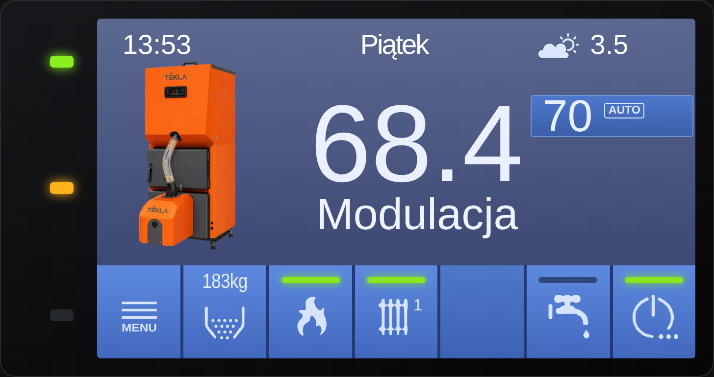
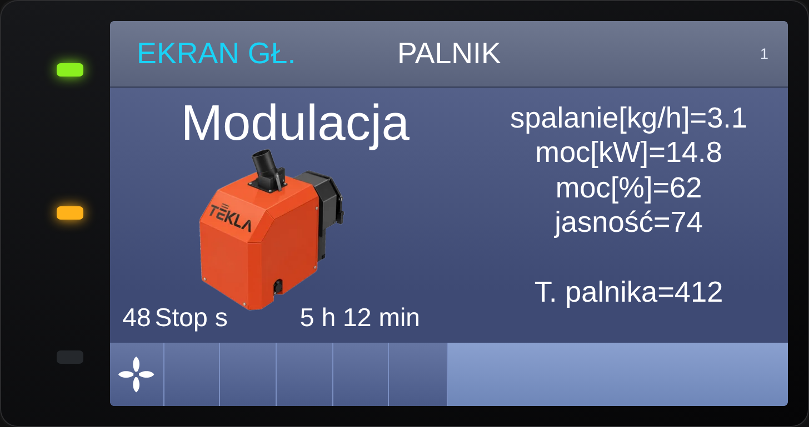
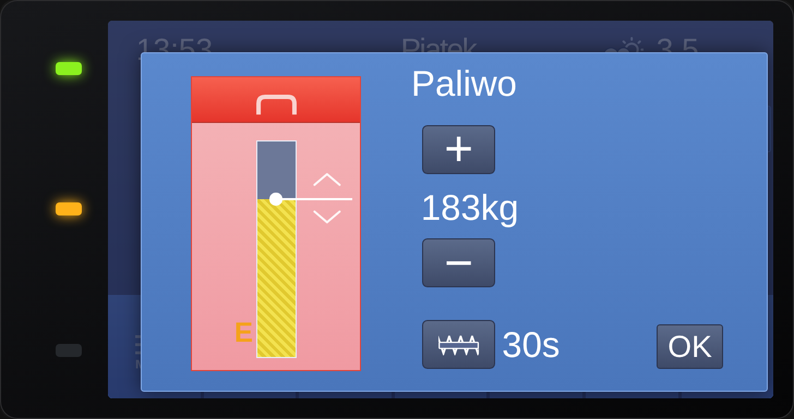

# PelletCAN

Karta Home Assistant (`custom:pelletcan-card`) – wierna replika panelu **Estyma / Tekla Igneo Touch** – oraz firmware **ESPHome** (XIAO ESP32-C6 + MCP2515), który czyta i zapisuje parametry kotła pelletowego po magistrali CAN (CANopen SDO, węzeł 4, 125 kbit/s). To **wersja pełna**: odczyt i zapis nastaw, harmonogramy, poziomy dostępu z PIN-em, test wyjść, statystyki, skaner rejestrów i diagnostyka magistrali.

Chcesz tylko **podglądu** (bez zapisu i bez narzędzi serwisowych)? Jest osobna, uproszczona wersja: **[PelletCAN lite](https://github.com/GieOeRZet/PelletCAN_lite)** – własna karta `custom:pelletcan-card-lite` i firmware tylko do odczytu.

Projekt stworzony przez Romana Gorza (pomysł, kierunek, testy na własnej instalacji) z pomocą Claude – asystenta AI firmy Anthropic, który pomagał przy pisaniu kodu i dokumentacji.

<a href="https://buycoffee.to/ergie" target="_blank" rel="noopener"></a>

> ⚠️ Projekt nieoficjalny – nie zastępuje produktów Estyma. Zobacz [Ważne zastrzeżenia](#ważne-zastrzeżenia).

> Zrzuty ekranu poniżej pochodzą z danych testowych (nie z działającego kotła).

| Ekran główny | Palnik | Menu |
|---|---|---|
|  |  |  |

Tryb demo (`demo: true`, bez ESP): [strona demo](docs/demo.html)

| Ekran główny | Palnik | Paliwo |
|---|---|---|
|  |  |  |

## Spis treści
1. [Pełna czy lite – co wybrać](#pełna-czy-lite--co-wybrać)
2. [Jak to działa](#jak-to-działa)
3. [Co jest w środku](#co-jest-w-środku)
4. [Sprzęt i połączenie](#sprzęt-i-połączenie)
5. [Szybki start – od zera do działającej karty](#szybki-start--od-zera-do-działającej-karty)
6. [Plik secrets.yaml – wymagane wpisy](#plik-secretsyaml--wymagane-wpisy)
7. [Ustawienia firmware (substitutions)](#ustawienia-firmware-substitutions)
8. [Adres IP: stały albo DHCP](#adres-ip-stały-albo-dhcp)
9. [Awaryjny punkt dostępu Wi-Fi](#awaryjny-punkt-dostępu-wi-fi)
10. [Karta – instalacja i konfiguracja](#karta--instalacja-i-konfiguracja)
11. [Poziomy dostępu i PIN-y](#poziomy-dostępu-i-pin-y)
12. [Przegląd ekranów](#przegląd-ekranów)
13. [Encje wystawiane przez ESPHome](#encje-wystawiane-przez-esphome)
14. [Akcje (usługi) dla Home Assistant](#akcje-usługi-dla-home-assistant)
15. [Diagnostyka i skanery rejestrów](#diagnostyka-i-skanery-rejestrów)
16. [Co ustaliliśmy – protokół, rejestry i firmware panelu](#co-ustaliliśmy--protokół-rejestry-i-firmware-panelu)
17. [Przykłady użycia](#przykłady-użycia)
18. [Aktualizacje](#aktualizacje)
19. [Rozwiązywanie problemów](#rozwiązywanie-problemów)
20. [Struktura repozytorium](#struktura-repozytorium)
21. [Ważne zastrzeżenia, licencja, wsparcie](#ważne-zastrzeżenia)

## Pełna czy lite – co wybrać
| | **PelletCAN (ta wersja)** | [**PelletCAN lite**](https://github.com/GieOeRZet/PelletCAN_lite) |
|---|---|---|
| Karta | `custom:pelletcan-card` | `custom:pelletcan-card-lite` (osobny plik, bez kodu zapisu i ekranów serwisowych) |
| Zapis do kotła | tak: nastawy, tryby, harmonogramy, włącz/wyłącz, podajnik, dmuchawa | **nie** – wyłącznie odczyt |
| Poziomy dostępu i PIN | poziom 0, klucz 1 (PIN 0900), klucz 2 (PIN 0999) | tylko poziom podstawowy, bez „Poziom menu” |
| Test wyjść, Statystyki, Sieć, Konfiguracja | tak | nie |
| Skaner rejestrów, podsłuch SDO, Snap A/B, raport diagnostyczny | tak | **nie ma** |
| Akcje (usługi) dla HA | 18 | 0 |
| Encje ESPHome (wg definicji w YAML) | ok. 193: 120 sensorów, 13 binarnych, 44 tekstowe, 2 przełączniki, 3 wybory, 11 przycisków | ok. 86: 46 sensorów, 9 binarnych, 31 tekstowych; bez przycisków, przełączników i wyborów |
| Dla kogo | chcesz sterować kotłem z HA i rozwijać projekt | chcesz bezpiecznie oglądać kocioł, np. dla domowników albo bez ryzyka zapisu |

Obie wersje czytają ten sam kocioł, ale **nie wgrywaj ich razem na jedno ESP** – to dwa osobne firmware. Kartę lite i pełną można mieć w HA jednocześnie.

## Jak to działa
```
 kocioł Tekla/Estyma           ESP (XIAO ESP32-C6 + MCP2515)                 Home Assistant
┌───────────────────┐  CAN   ┌────────────────────────────────┐  Wi-Fi  ┌──────────────────────────┐
│ sterownik (węzeł 4)│◄──────►│ węzeł 90: zapytania SDO,       │◄───────►│ integracja ESPHome:      │
│ panel Igneo Touch  │ 125k   │ nasłuch PDO, kolejka odczytu,  │  API    │ encje + akcje            │
│ moduł (węzeł 86)   │        │ zapis, poziomy dostępu, liczone│ (szyfr.)│ karta pelletcan-card     │
└───────────────────┘        │ w ESP: moc kW, spalanie, prognoza└────────┴──────────────────────────┘
```
- **Magistrala:** kocioł, panel i moduły rozmawiają po CAN 125 kbit/s protokołem **CANopen**. Sterownik kotła to **węzeł 4**, dodatkowy moduł (wymiennik) to **węzeł 86**. ESP dołącza jako **węzeł 90** (numery 86 i 87 są zajęte).
- **Odczyt (SDO):** ESP wysyła do sterownika zapytania „daj rejestr 0xINDEKS.sub” i dostaje odpowiedź. Każda nastawa, temperatura czy licznik to jeden rejestr. Katalog 593 rejestrów węzła 4 jest w [`rejestry/`](rejestry/README.md).
- **Kolejka odczytu:** ESP odpytuje rejestry cyklicznie w kolejce (nastawy poziomu 0 stale, klucz 1 i 2 po PIN-ie, po zapisie lub na żądanie). Temperatury i stany przychodzą też w ramkach **PDO**, które kocioł wysyła sam.
- **Zapis:** karta wywołuje akcję ESPHome (np. `set_param`), a ESP zapisuje rejestr kodując wartość tak jak panel (np. flaga+bajt `256 + wartość`). Kocioł odrzuca wartości spoza zakresu. Zapis zatrzymują: tryb **mirror**, wyłączniki `*_write` w YAML oraz zbyt niski poziom dostępu.
- **Liczone w ESP:** moc palnika [kW] i spalanie [kg/h] (sprawność z `burner_eff_kw`, `burner_eff_fuel`), zużycie paliwa z 24 h i prognoza dni do końca paliwa, historia 20 alarmów.
- **Karta:** czyta encje ESPHome (znajduje je sama po prefiksie nazwy), rysuje panel i wywołuje akcje. Nie wymaga szablonów ani helperów.
- **Poziomy dostępu:** PIN wpisany w karcie trafia do ESP (akcja `unlock`), ESP trzyma poziom, a po 5 min bezczynności wraca do 0.

## Co jest w środku
- **Firmware ESPHome** – plik użytkownika `esphome/PelletCAN.yaml` (ustawienia) + rdzeń `esphome/PelletCAN_packages.yaml` (logika, pobierany z GitHuba przy kompilacji) – odczyt temperatur, trybów, alarmów, harmonogramów i ustawień palnika, zapis nastaw, moc palnika w kW i spalanie liczone w ESP, poziomy dostępu z PIN-em, historia 20 alarmów z kotła.
- **Karta** (`dist/pelletcan-card.js`) – jeden plik wejściowy. Ma ekrany jak panel (główny, Ogrzewanie, Woda, Palnik, Menu z podmenu), edycję nastaw i harmonogramów, historię alarmów.
- **Katalog rejestrów CANopen i skaner** ([`rejestry/`](rejestry/README.md)) – pełny katalog rejestrów węzła 4 i 86 (zakresy, kodowanie, R/W, co jest już wykorzystane) oraz instrukcja szukania nowych rejestrów.

Karta nie wymaga szablonów (template sensors) ani helperów w HA. Elementy bez encji pokazują „-”.
## Sprzęt i połączenie
- Home Assistant z integracją **ESPHome** (dodatek ESPHome do kompilacji).
- Płytka **Seeed XIAO ESP32-C6** z **Seeed CAN Bus Breakout** (MCP2515, kwarc 16 MHz).
- Połączenie CAN z kotłem: CAN-H, CAN-L, masa; zasilanie 5 V. Zworka P1 = terminator 120 Ω (domyślnie rozłączona; włączaj tylko gdy ESP jest na końcu magistrali).
- Piny SPI: SCK = GPIO19 (D8), MISO = GPIO20 (D9), MOSI = GPIO18 (D10), CS = GPIO17 (D7).
- Inny ESP lub moduł MCP2515: piny i prędkość SPI w `PelletCAN.yaml` (`pin_spi_clk`, `pin_spi_mosi`, `pin_spi_miso`, `pin_can_cs`, `can_spi_rate`; dla XIAO z anteną zewnętrzną `pin_rf_switch`, `pin_rf_antenna`) i sekcja `esp32: board:`. Prędkość i kwarc: `can_bitrate` (`125KBPS`), `can_clock` (`16MHZ`).

## Szybki start – od zera do działającej karty
Czego potrzebujesz: Home Assistant z dodatkiem **ESPHome**, zainstalowany **HACS**, płytka z modułem CAN (sekcja powyżej) i kabel USB-C do pierwszego wgrania.

1. **Podłącz sprzęt** do magistrali CAN kotła i do zasilania 5 V.
2. **Uzupełnij `secrets.yaml`** – w ESPHome przycisk **Secrets** w prawym górnym rogu:
   ```yaml
   wifi_ssid_iot: "NAZWA_SIECI"                 # sieć 2,4 GHz (ESP32-C6 nie widzi 5 GHz)
   wifi_pass: "HASLO_WIFI"
   esp_api_key_tekla_CAN: "KLUCZ_API"           # 32 bajty w base64
   ota_pass: "HASLO_OTA"                        # dowolne hasło do aktualizacji przez Wi-Fi
   ```
   Klucz API: `openssl rand -base64 32` albo przycisk generowania na <https://esphome.io/components/api.html>. Nazwy kluczy muszą być dokładnie takie. Wzór: [`esphome/secrets.example.yaml`](esphome/secrets.example.yaml).
3. **Nowe urządzenie w ESPHome** → **Skip** → wklej zawartość [`esphome/PelletCAN.yaml`](esphome/PelletCAN.yaml). W `substitutions` ustaw swoje IP (albo przejdź na DHCP), liczbę obiegów CO (`dwa_obiegi_co`) i antenę. Cały kod pobierze się sam z GitHuba.
4. **Install** → pierwsze wgranie po kablu USB (jeśli port się nie pojawia, przytrzymaj BOOT podczas podłączania). Kolejne aktualizacje idą przez Wi-Fi.
5. **Dodaj urządzenie w HA**: Ustawienia → Urządzenia i usługi → ESPHome (klucz API z `secrets.yaml`). Pojawią się encje o nazwach z prefiksem `tekla`.
6. **Zainstaluj kartę** przez HACS (repo `https://github.com/GieOeRZet/PelletCAN`, kategoria **Dashboard**), odśwież przeglądarkę (Ctrl+F5) i dodaj `custom:pelletcan-card` do dashboardu.
7. **Sprawdź**: na ekranie głównym są temperatura kotła i stan pracy, a encja „CAN OK” = włączona. Przy „-” patrz [Rozwiązywanie problemów](#rozwiązywanie-problemów).

Wersje firmware: **`main`** (plik użytkownika + rdzeń pobierany z GitHuba przy kompilacji; wymaga internetu w ESPHome) i **`test`** (jeden kompletny plik `esphome/tekla-estyma.yaml`, wszystko lokalnie: `git clone -b test https://github.com/GieOeRZet/PelletCAN.git`).

## Plik secrets.yaml – wymagane wpisy
Wzór: `esphome/secrets.example.yaml`. Plik `secrets.yaml` nie trafia do repozytorium (`.gitignore`).

| Klucz | Do czego | Uwagi |
|---|---|---|
| `wifi_ssid_iot` | nazwa sieci Wi-Fi | sieć 2,4 GHz |
| `wifi_pass` | hasło sieci Wi-Fi | |
| `esp_api_key_tekla_CAN` | klucz szyfrowania API (HA ↔ ESP) | 32 bajty w base64; wygeneruj w ESPHome (*Encryption key*) |
| `ota_pass` | hasło aktualizacji bezprzewodowej (OTA) | dowolne, silne |

**Hasło awaryjnej sieci (`ap_pass`) NIE jest w `secrets.yaml`** – jest jawne w sekcji `substitutions` pliku `PelletCAN.yaml` (domyślnie `11223344`) i możesz je tam zmienić. Dotyczy tylko awaryjnej sieci `Tekla-Estyma Fallback`.

PIN-y instalatora (0900 = klucz 1, 0999 = klucz 2) to domyślne PIN-y z oprogramowania panelu Tekla – są jawne w YAML (`pin_installer1`, `pin_installer2`) i nie wymagają wpisu w `secrets.yaml`.
## Ustawienia firmware (substitutions)
Zmieniasz tylko sekcję `substitutions` w `PelletCAN.yaml`, rdzenia nie edytujesz.

| Grupa | Ustawienia | Opis |
|---|---|---|
| Wi-Fi i IP | `wifi_ssid`, `wifi_password`, `ap_pass`, `device_ip`, `device_gateway`, `device_subnet` | patrz niżej: stały adres lub DHCP |
| Klucze | `api_key`, `ota_password` | z `secrets.yaml` |
| Układ CO | `dwa_obiegi_co` | `false` = jeden obieg „CO”, `true` = CO1 i CO2 |
| Nazwa | `name`, `friendly_name` | nazwa ESPHome i prefiks encji (domyślnie `tekla-estyma`, „Tekla”) |
| CAN i piny | `can_bitrate`, `can_clock`, `pin_*`, `can_spi_rate`, `external_antenna` | wg sekcji Sprzęt |
| Dostęp | `pin_installer1`, `pin_installer2`, `pin_autolock_min` | PIN-y klucza 1 i 2, blokada po bezczynności (0 = bez blokady) |
| Zapis | `mirror`, `write_enabled`, `power_write`, `mode_write`, `schedule_write`, `setpoint_write`, `feeder_write`, `blower_write`, `alarm_confirm`, `output_test_write` | wyłączniki zapisu; `mirror: "true"` blokuje wszystkie zapisy (ESP tylko czyta) |
| Czasy | `blower_on_seconds`, `feeder_on_seconds`, `test_revert_s` | czasowe włączenie dmuchawy/podajnika, powrót testu wyjść do automatu |
| Obliczenia | `temp_div`, `burner_eff_kw`, `burner_eff_fuel` | skalowanie temperatur, sprawność do mocy i spalania |
| Diagnostyka | `can_debug`, `sniff`, `diag_log`, `can_auto_restart`, `can_node_id`, `can_identity`, `can_heartbeat`, `can_product` | patrz [Diagnostyka](#diagnostyka-i-skanery-rejestrów) |

## Adres IP: stały albo DHCP
Adresy wpisujesz w `substitutions` pliku `esphome/PelletCAN.yaml`:
```yaml
  device_ip: 192.168.10.250      # Twój adres (wpisz swoje wartości!)
  device_gateway: 192.168.10.1   # brama (router)
  device_subnet: 255.255.254.0   # maska sieci
```
Na dole pliku jest blok `wifi: manual_ip`, który tych wartości używa. **Chcesz DHCP?** Usuń albo zakomentuj cały blok `wifi:` – wtedy HA znajdzie urządzenie po nazwie `tekla-estyma`. Adresy to sieć lokalna, więc nie trafiają do `secrets.yaml`.
## Awaryjny punkt dostępu Wi-Fi
Jeśli ESP nie połączy się z siecią (zmiana routera, złe hasło, nowa sieć), po ok. minucie sam wystawia sieć **`Tekla-Estyma Fallback`** (hasło z `substitutions: ap_pass` w YAML, domyślnie `11223344`). Po połączeniu otwiera się strona logowania (portal captive; jeśli nie – wejdź na `192.168.4.1`), gdzie wybierasz sieć i wpisujesz hasło. Urządzenie zapisuje dane i łączy się z siecią. Ponieważ w firmware jest stały adres IP (`device_ip`), w nowej sieci musi on pasować do jej podsieci – w razie potrzeby wgraj firmware z poprawionym adresem. Po powrocie do sieci urządzenie pojawi się w ESPHome i w HA.
## Karta – instalacja i konfiguracja
**HACS (zalecane):** HACS → ⋮ → *Niestandardowe repozytoria* → `https://github.com/GieOeRZet/PelletCAN`, kategoria **Dashboard** → *Pobierz*. Zasób `/hacsfiles/PelletCAN/pelletcan-card.js` dodaje się sam. **Ręcznie:** zawartość `dist/` do `/config/www/community/pelletcan/` i zasób `/local/community/pelletcan/pelletcan-card.js?v=1` (po aktualizacji zmień `?v=`). Nie dodawaj obu naraz. Po instalacji Ctrl+F5.

Najprostsza karta:
```yaml
type: custom:pelletcan-card
```
Karta **sama znajduje encje** urządzenia po nazwie (prefiks `tekla`). Pozycje bez encji pokazują „-”, brak encji nie powoduje błędu.

### Opcje YAML
| Opcja | Domyślnie | Opis |
|---|---|---|
| `screen` | `main` | ekran startowy (`main`, `heat`, `water`, `burn`, `menu`, `alarm`, `info` i inne – lista w edytorze) |
| `language` | `pl` | język interfejsu: `pl`, `en`, `dk`, `de`, `se`, `lt`, `sk`, `cz`, `es`, `ro`, `est` (też kody `da sv cs et`) albo `auto` (język Home Assistant); wybór także w edytorze – pole „Język / Language” |
| `lite` | `false` | stary tryb „lite” tej karty (poziom 0 bez PIN-u). Nowa, osobna i bezpieczniejsza wersja: [PelletCAN lite](https://github.com/GieOeRZet/PelletCAN_lite) |
| `grafiki` | `domyslne` | `pelne` = oryginalne grafiki panela (wentylator, podajniki, zawór, grzałka, kocioł, palnik) z `dist/img/panel`; wybór także w edytorze |
| `boiler_image` | `13` | typ obrazu kotła przy grafikach pełnych: `11`, `12`, `13` |
| `entity_prefix` | `tekla` | fragment nazwy urządzenia używany do wykrywania encji |
| `esphome_node` | `tekla_estyma` | nazwa węzła ESPHome (usługi `esphome.<węzeł>_...`) |
| `demo` | `false` | `true` = dane przykładowe bez ESP/HA (zrzuty, test wyglądu; [docs/demo.html](docs/demo.html)) |
| `mirror` | z ESP | `true` blokuje zapisy w tej karcie (tylko podgląd) |
| `entities` | – | ręczne wskazanie encji dla wybranych pozycji (nadpisuje wykrywanie) |

```yaml
type: custom:pelletcan-card
screen: main
entity_prefix: tekla
entities:
  boiler_temp: sensor.moj_kociol_temperatura   # opcjonalnie – własna encja zamiast wykrytej
```

### Edytor wizualny
Edytor jest podzielony tak jak karta – według ekranów i menu:
1. **Ogólne** – ekran startowy, prefiks encji, węzeł ESPHome, tryb mirror (u góry widać, ile pozycji wykryto automatycznie i których brakuje).
2. **Ekran główny i ekran Kocioł**, **Ekran główny – Palnik i zbiornik**, **Ekran Ogrzewanie (CO)**, **Ekran Woda użytkowa (CWU)**.
3. **Menu →** Palnik → NASTAWY (użytkownik / klucz 1 / klucz 2), Ciepła woda → NASTAWY, Ogrzewanie obwód 1 → NASTAWY, Kocioł → NASTAWY, Historia alarmów, Statystyki i Test wyjść.
4. **System** – łączność CAN, tryb mirror, poziom dostępu.


### Grafiki
Karta używa `img/kociol.*`, `img/palnik.*`, `img/bojler.*` (png, webp, jpg, jpeg, svg – w tej kolejności). Wgraj własny plik do folderu `img/` obok karty (HACS: `/config/www/community/PelletCAN/img/`), aby podmienić domyślny, i odśwież stronę (Ctrl+F5). Folder `img/panel/` zawiera grafiki panela; opcja `grafiki: pelne` (też w edytorze karty) włącza wentylator, podajniki, zawór, grzałkę, kocioł (`boiler_image` 11/12/13) i palnik.

## Poziomy dostępu i PIN-y
- **Poziom 0** – użytkownik: Kocioł, Palnik, Ogrzewanie obwód 1, Ciepła woda, Historia alarmów, Informacje.
- **Klucz 1** (PIN 0900) – dodatkowo Język, Alarm dźwiękowy, Konfiguracja, Test wyjść (podgląd), Statystyki, Sieć oraz nastawy palnika klucza 1.
- **Klucz 2** (PIN 0999) – dodatkowo nastawy palnika klucza 2 (bezwładność, ruch rusztu, itd.) oraz **sterowanie w Teście wyjść**.

PIN wpisuje się w menu **Poziom menu (PIN)**. Poziom jest utrzymywany w ESP (sensor „Poziom dostępu”), wraca do 0 po 5 min bezczynności (`pin_autolock_min`) i po restarcie. Po wpisaniu któregokolwiek PIN-u ustawienia danego poziomu odświeżają się automatycznie. ESP odrzuca zapis parametru wymagającego wyższego poziomu.

Odczyt ustawień: po starcie ESP czyta wszystkie ustawienia (najpierw poziom 0), poziom 0 jest odświeżany cyklicznie, a klucz 1 i 2 – po PIN-ie, po zapisie i na żądanie (klik w nazwę dnia tygodnia na ekranie głównym).

## Przegląd ekranów
| Ogrzewanie | Woda | Kocioł |
|---|---|---|
|  |  |  |

| Nastawy palnika | Nastawy ogrzewania | Nastawy wody |
|---|---|---|
|  |  |  |

| Historia alarmów | Harmonogram | Informacje |
|---|---|---|
|  |  |  |

| Szybkie ustawienia | Paliwo | PIN |
|---|---|---|
|  |  |  |

| Nastawy palnika, klucz 1 | Nastawy palnika, klucz 2 |
|---|---|
|  |  |

Historia alarmów jest czytana z bufora kotła (20 ostatnich wpisów, encje „Alarm wpis 1..20” – działa od pierwszych wersji firmware).

## Encje wystawiane przez ESPHome
Nazwy encji mają prefiks urządzenia (np. `sensor.kotlownia_tekla_temperatura_powrotu`; prefiks zależy od nazwy urządzenia w HA). W sumie ok. 193 encji:

| Grupa | Przykłady |
|---|---|
| Temperatury i zadane | Kociol temperatura, CO/CO1/CO2 temperatura, CWU temperatura, Temperatura zewnetrzna, Temperatura powrotu, Temperatura palnika; zadane ręczne / wynikowe / komfort / ekonomiczna |
| Stan pracy | Palnik stan, Palnik kod stanu, Kociol tryb pracy, tryby CO/CWU, Poziom dostepu; binarne: CAN OK, Kociol wlaczony, Alarm aktywny, pompy CO/CWU, Dmuchawa pracuje, Podajnik pracuje, Zakaz rozpalenia, Regulator pokojowy zgoda |
| Palnik | moc [kW] i [%], spalanie [kg/h], jasność płomienia, zapalarka, obroty i moc dmuchawy, krzywa modulacji dmuchawy 20–100 %, parametry rozpalania/rozżarzania/wygaszania, czyszczenie rusztu |
| Nastawy kotła, CO, CWU | min. temp. pomp/powrotu, czas mieszacza, histerezy, krzywa pogodowa CO (−20/0/+10 °C), antylegionella, priorytet CWU, krzywa wentylatora spalin 1–5, alarm dźwiękowy i godziny ciszy |
| Zbiornik i paliwo | Zbiornik pojemnosc / paliwo / zapelnienie, Paliwo zuzycie 24h, Paliwo prognoza [dni], Paliwo rezerwa |
| Alarmy | Ostatni alarm, Alarm poczatek / koniec, Alarm wpis 1–20, Alarm rejestr |
| Harmonogramy | CWU / CO / Kociol harmonogram (rejestry) – karta rysuje z nich paski 0–24 |
| Konfiguracja i statystyki | Konfiguracja kotla (18 rejestrów, tylko odczyt), Statystyki kotla (średnie moce i tlen, energia całkowita), Test wyjsc stany |
| Przyciski | Potwierdz alarm; Podajnik: Automat / Wylacz / Podaj paliwo (30 s); Dmuchawa: Automat / Wylacz / Wlacz (czasowo); Snap A / Snap B / Snap STOP; Raport diagnostyczny (utworz) |
| Przełączniki i wybory | Kociol wlacz/wylacz, Restart; CO (CO1, CO2) tryb ustaw, CWU tryb ustaw |
| Diagnostyka | SDO ostatni odczyt, CAN diag, CAN ID ramek, Zmiany rejestrow (Snap), Raport diagnostyczny, Wersja firmware, Sygnatura konfiguracji |

## Akcje (usługi) dla Home Assistant
Akcje mają postać `esphome.<nazwa_urządzenia>_<akcja>` (np. `esphome.tekla_estyma_set_param`; dokładną nazwę zobaczysz w Narzędzia deweloperskie → Akcje, wpisz „sdo”). Karta używa ich sama; możesz je wołać z automatyzacji i skryptów.

| Akcja | Parametry | Działanie |
|---|---|---|
| `unlock` | `pin` | ustawia poziom dostępu (PIN klucza 1 lub 2; błędny = poziom 0) |
| `set_setpoint` | `which` (0 CWU komfort, 1 CWU eco, 2 CO komfort, 3 CO eco, 4 kocioł ręczna), `value` [°C] | zapis temperatury zadanej w dozwolonym zakresie |
| `set_boiler_mode` | `mode` (0 czasowy auto, 1 czasowy ręczny, 2 auto, 3 ręczny) | tryb zadawania temperatury kotła |
| `set_param` | `key`, `value` | zapis nastawy menu (numer pozycji: palnik, kocioł, CO, CWU); wymaga właściwego poziomu dostępu |
| `set_schedule` | `kind` (0 CWU, 1 CO, 2 kocioł), `day` (0 Pn … 6 Nd), `bits` (24 bity, bit i = godzina i, 1 = komfort) | zapis harmonogramu |
| `set_output`, `set_output_pct` | `out`, `mode` (0 automat, 1 OFF, 2 ON); `value` [%] | **Test wyjść** (wymaga klucza 2); po `test_revert_s` wraca do automatu |
| `test_refresh`, `test_reset` | – | odczyt stanu testu wyjść / powrót wszystkich do automatu |
| `alarm_refresh`, `param_refresh`, `schedule_refresh` | – | wymuszenie odczytu alarmów, nastaw, harmonogramów |
| `sdo_read` | `index`, `sub` | odczyt jednego rejestru (wynik w „SDO ostatni odczyt”) |
| `sdo_scan`, `sdo_scan_stop` | `from_index`, `to_index` (dziesiętnie), `sub`, `node` | **skaner rejestrów** zakresu indeksów, przerwanie skanu |
| `sdo_write` | `index`, `sub`, `value`, `size` (1/2/4) | surowy zapis rejestru (wymaga `write_enabled` i braku `mirror`) |
| `sdo_poll_add`, `sdo_poll_clear` | `index` | dodaje / czyści dodatkowy rejestr w cyklicznym odczycie (do restartu) |

## Diagnostyka i skanery rejestrów
Domyślnie firmware jest „cichy”: log ESPHome pokazuje tylko to, co ważne. Narzędzia do szukania rejestrów włączasz w razie potrzeby.

**Skaner rejestrów (`sdo_scan`)** czyta kolejne rejestry węzła (domyślnie 4, kocioł) i zapisuje wyniki w encji „SDO ostatni odczyt” (historia encji = log skanu). Skan jest jeden naraz, ok. 10–12 rejestrów/s; część odpowiedzi ginie na magistrali, więc blok skanuj 2–3 razy. Skan węzła 86 (wymiennik): `from_index: 25088`, `to_index: 25632`, `sub: 1`, `node: 86`.

**Metoda różnicowa** – jak znaleźć rejestr pozycji menu, której jeszcze nie ma w firmware: zmień na panelu jedną nastawę na niecodzienną wartość, przeskanuj strefy rejestrów i szukaj tej wartości (dla typu flaga+bajt `256 + wartość`). Pełna instrukcja, strefy, kodowanie i dodawanie rejestru do firmware i karty: **[rejestry/README.md](rejestry/README.md)**; katalog online: [strona katalogu](https://gieoerzet.github.io/PelletCAN/katalog.html).

**Snap A / Snap B** – ESP sam robi skan różnicowy: *Snap A* zapisuje punkt odniesienia (593 rejestry, ok. 72 s), zmieniasz JEDNĄ nastawę na panelu, *Snap B* publikuje listę zmian `XXXX:stara>nowa` w encji „Zmiany rejestrow (Snap)”. Nie rób tego w trakcie rozpalania.

**Raport diagnostyczny** – przycisk „Raport diagnostyczny (utworz)” składa tekst (wersja, czas pracy, Wi-Fi, CAN, liczniki SDO) do wklejenia w [Issue](https://github.com/GieOeRZet/PelletCAN/issues/new/choose); bez haseł i adresów.

**Przełączniki diagnostyczne w `PelletCAN.yaml`** (po diagnozie przywróć `"false"`):
| Ustawienie | Działanie |
|---|---|
| `diag_log` | dodatkowe wpisy: NMT, IDENT, zmiany PDO, raport SKAN SIECI |
| `sniff` | podsłuch SDO innych węzłów, m.in. **zapisy panelu** w logu ESPHome |
| `can_debug` | log wszystkich ramek CAN |
| `can_node_id`, `can_identity`, `can_heartbeat` | ESP jako węzeł 90 widoczny w zakładce Sieć panelu (nazwa PelletCAN, wersja) |

Szczegóły i typowe zadania: [docs/DIAGNOSTYKA.md](docs/DIAGNOSTYKA.md). **Uwaga:** `sdo_write` i skany wykonuj ostrożnie – zapis złego rejestru może zmienić pracę kotła.

## Co ustaliliśmy – protokół, rejestry i firmware panelu
Ta część zbiera wszystko, co udało się ustalić o kotle i panelu. Szczegółowe dane są w folderze [`rejestry/`](rejestry/README.md) (CSV otwierane w Excelu/LibreOffice).

### Magistrala i węzły
- CAN 125 kbit/s, ramki 11-bitowe, **CANopen**: odczyt i zapis przez **SDO** (indeks 16 bit + sub), stany przez **PDO** (np. 0x356 / 0x456) i **NMT** (heartbeat, boot-up).
- **Węzeł 4** – sterownik kotła (593 rejestry, wszystkie przeskanowane w zakresie 0x0000–0xFFFF, sub 1). **Węzeł 86** – moduł wejść/wyjść CAN IO BIG (CiA 401: 0x6000, 0x6200, 0x6400…), m.in. wymiennik. Panel Igneo Touch to osobny węzeł. ESP dołącza jako **węzeł 90** (86 i 87 są zajęte) i odpowiada na zapytania tożsamości (0x1000, 0x1008, 0x100A, 0x1018), dzięki czemu panel widzi je w zakładce Sieć jako „PelletCAN” z wersją softu.
- SDO działa tylko dla **sub 1** (wartość); sub 2 = typ, sub 3/4 = zakres min/max. Rejestry nieistniejące nie dają odpowiedzi, a część odpowiedzi ginie przy ruchu panelu, dlatego skany powtarza się 2–3 razy.

### Kodowanie wartości
Większość nastaw menu to U16 w postaci **flaga + bajt** (`raw = 256 + wartość`), reszta to liczba bez flagi, ułamek ×10, przełącznik `256`/`257`, wybór z listy `256 + indeks`, maska 24-bitowa godzin dla harmonogramów (bit i = godzina i) i znacznik czasu Unix dla alarmów. Pełna tabela: [rejestry/README.md](rejestry/README.md#kodowanie-wartości-rejestry-u16-sub-1-zapis-cs-0x2b--2-bajty). Kocioł **odrzuca zapis spoza zakresu** (sub 3/4), więc zakres sprawdza się zapisem wartości skrajnych.

### Katalog rejestrów
- [`katalog-rejestrow.csv`](rejestry/katalog-rejestrow.csv): 693 wiersze (węzły 4 i 86; w tym 76 parametrów znanych tylko z firmware panelu) z nazwą, statusem (`POTWIERDZONY`, `PRZYPISANY`, `KANDYDAT`, `NIEZNANY`), zakresem, kodowaniem, dostępem, poziomem menu (PIN) oraz informacją, czy rejestr jest użyty w firmware i gdzie. Wersja do przeglądania: [strona katalogu](https://gieoerzet.github.io/PelletCAN/katalog.html).
- [`alarmy-kody.csv`](rejestry/alarmy-kody.csv): 54 kody alarmów z opisem (np. 1 czujnik kotła, 2 przegrzanie kotła, 140 brak ognia/opału). Historia: 20 wpisów w buforze kotła (kod 0x4010+i, początek 0x4024+i, koniec 0x4038+i, w sekundach Unix).
- Mapa adresowa węzła 4: 0x2001–0x2067 ustawienia podstawowe i tryby, 0x2101–0x2160 harmonogramy i parametry palnika, 0x2161–0x216F nastawy kotła, 0x2207–0x2314 kocioł/palnik/dmuchawa/pompy/CO1/test wyjść, 0x3000–0x3174 i 0x3500–0x352B serwis i liczniki, 0x3600–0x3665 zbiornik i statystyki, 0x3700–0x3728 palnik, 0x4000–0x404D pomiary i alarmy.

### Co zostało rozszyfrowane
- **Menu Kocioł (klucz 1):** min. temp. pomp `0x2207`, wybieg pompy `0x3708`, min. temp. powrotu `0x216C`, czas mieszacza `0x216E`, rezerwa paliwa stop `0x3604`.
- **Menu Ogrzewanie 1 (klucz 1):** wszystkie 13 pozycji (`0x22B1`, `0x22D5`, `0x22D9`, `0x22DD`, `0x22E1`, `0x22E5`, `0x22E9`, `0x22B5`, `0x22F1`, `0x22F9`, `0x22D1`, `0x22A5`, `0x22A1`).
- **Krzywa pogodowa CO1:** trzy punkty zależności temperatury zasilania od temperatury zewnętrznej: −20 °C = `0x22C5`, 0 °C = `0x22C9`, +10 °C = `0x22CD` (zakres 20–80 °C). Panel ma **tylko te trzy punkty**, więc nie ma punktu −10 °C; kocioł interpoluje między nimi. Tryb pracy CO (ręczny/pogodowy) = `0x2142`.
- **Palnik i dmuchawa:** krzywa modulacji dmuchawy dla mocy 20/40/60/80/100 % = `0x2261`–`0x2265`, zapalarka `0x2253`, jasność płomienia `0x2250`, czas podawania `0x226D`, parametry rozpalania, rozżarzania i wygaszania.
- **Z firmware panelu:** temp. maks. CWU `0x201C` (40–80 °C), antylegionella `0x2297` (tylko flaga – panel nie ma dnia ani godziny), krzywa wentylatora spalin `0x2268`/`0x226E`/`0x226F`/`0x2275`/`0x227A`, alarm dźwiękowy `0x3506` i godziny ciszy `0x3508`/`0x3509`, statystyki `0x3610`/`0x3613`–`0x3616`/`0x3628`, zużycie paliwa `0x3710`, data serwisu `0x3718`/`0x3719`, pompa cyrkulacyjna CWU `0x374B`/`0x374C`, rezerwa paliwa `0x3603`, wersja softu `0x3664`, kaskada `0x3511`–`0x351C`, zewnętrzny magazyn paliwa `0x351E`–`0x352B`.
- **Test wyjść:** podajnik `0x2259`, dmuchawa `0x2283`, zapalarka `0x2284`, podajnik palnika `0x2295`, pompa CWU `0x2296`, pompy CO `0x229D`–`0x22A0`, mieszacze CO1–CO4 `0x214A`–`0x214D` (rejestry `0x22B9`–`0x22BC` to tylko stan), wymiennik `0x2285`. Wyjścia 0–21, tryby A (automat) / OFF / ON; wymaga klucza 2.

### Analiza firmware panelu Igneo Touch (FW2213TK)
Dla zrozumienia protokołu i zgodności z własnym panelem przeanalizowano obraz firmware panelu (własnego, legalnie zakupionego urządzenia). Samego pliku firmware panelu w repozytorium nie ma; publikowane są ustalenia o rejestrach (nazwy, typy, zakresy).
- Układ **STM32F4**, interfejs **TouchGFX**, prawidłowa baza ładowania obrazu to `0x08010000`, teksty w UTF-16 w 7 językach (PL/EN/CZ/RO/LT/EE/ES).
- **Tablica par (indeks CANopen ↔ ID parametru panelu):** 420 par, [`panel-fw-mapa-indeks-id.csv`](rejestry/panel-fw-mapa-indeks-id.csv). Potwierdzone m.in. 0x3708→ID 23, 0x2207→18, 0x216C→33, 0x3604→363.
- **Rejestracja parametrów w kodzie:** funkcja rejestrująca jest wywoływana 448 razy; ID parametru = indeks SDO. Wynik z nazwą, typem, min/max, wartością domyślną i rodzajem dostępu (0 live, 1 komenda, 2–3 nastawa): [`panel-fw-parametry-FW2213TK.csv`](rejestry/panel-fw-parametry-FW2213TK.csv). 372 z 448 jest w naszym katalogu, 76 jest poza nim.
- **Nazwy 197 rejestrów**, które kocioł zna, a firmware PelletCAN jeszcze nie używa: [`snap-197-nazwy-FW2213TK.csv`](rejestry/snap-197-nazwy-FW2213TK.csv); odczyt wartości bazowych: [`snap-197-baseline-2026-11-06.csv`](rejestry/snap-197-baseline-2026-11-06.csv). Skan 6.11: z 288 indeksów znanych panelowi, a nieużywanych w naszym firmware, **197 odpowiada na kotle, 91 nie** (m.in. 0x372F–0x374C, 0x228D–0x228F, 0x218A–0x218C, 0x3666–0x366B) – to zapewne opcje innych konfiguracji (kaskada, dodatkowe obiegi) albo identyfikatory tylko panelu.
- **Teksty panelu:** tablice wskaźników na napisy, osobna dla każdego języka; blok polski ma 495 wpisów (id 0–6 nazwy stanów, 33–34 nagłówki menu, od 61 nazwy ekranów, ok. 75–430 etykiety parametrów, 440–494 formaty jednostek). Kolejność tekstów odpowiada kolejności dodawania parametrów w firmware, **nie** kolejności w menu.
- **Ślepe uliczki:** powiązanie wiersza menu z rejestrem nie jest zwykłą tablicą (ID parametru i ID tekstu nie sąsiadują), adresy RAM parametrów występują w kodzie tylko ok. 42 razy, a poziomy dostępu (klucz 1/2) nie wynikają z pola `access` parametru. Dlatego układ menu i poziomy ustalano ze zdjęć panelu i metodą różnicową.

### Ustalone zachowania i pułapki
- Zapis mieszaczy CO2–CO4 z ESP jest odrzucany przez kocioł (zmienia je tylko panel).
- Parametry odświeżają się po PIN-ie, po zapisie i cyklicznie; poziom 0 jest czytany stale, klucz 1 i 2 na żądanie.
- Moc palnika [kW] zgadza się z panelem przy sprawności 0,90, a spalanie [kg/h] przy współczynniku 0,85 (dopasowanie empiryczne).
- W historii encji w HA skrót `1m` oznacza **miesiąc**, nie minutę; do analizy skanów używaj czasu w formacie ISO UTC.

### Co jeszcze jest otwarte
Wymiennik w teście wyjść (węzeł 86), źródło sygnału „podajnik palnika pracuje” (PDO `0x356` bajt 2 bit 0, do potwierdzenia testem), powiązanie wszystkich wierszy menu z ID z binarki, nazwy i przeznaczenie reszty z 197 rejestrów oraz testy zapisów na kotle. Aktualne listy: [rejestry/README.md](rejestry/README.md#5-stan-na-22102026) i [rejestry/TODO.md](rejestry/TODO.md).

## Przykłady użycia
**1. Powiadomienie o alarmie kotła**
```yaml
alias: Kocioł – alarm
triggers:
  - trigger: state
    entity_id: binary_sensor.kotlownia_tekla_alarm_aktywny
    to: "on"
actions:
  - action: notify.notify
    data:
      title: Kocioł – alarm
      message: "{{ states('sensor.kotlownia_tekla_ostatni_alarm') }}"
```

**2. Powiadomienie o kończącym się paliwie**
```yaml
alias: Kocioł – paliwo
triggers:
  - trigger: state
    entity_id: binary_sensor.kotlownia_tekla_paliwo_rezerwa
    to: "on"
  - trigger: numeric_state
    entity_id: sensor.kotlownia_tekla_paliwo_prognoza
    below: 2
actions:
  - action: notify.notify
    data:
      message: "Zostało ok. {{ states('sensor.kotlownia_tekla_paliwo_prognoza') }} dni paliwa."
```

**3. Obniż temperaturę CO, gdy nikogo nie ma** (zadana CO ekonomiczna 20 °C → zapis do kotła)
```yaml
alias: Kocioł – tryb ekonomiczny po wyjściu
triggers:
  - trigger: state
    entity_id: group.domownicy
    to: not_home
actions:
  - action: esphome.tekla_estyma_set_setpoint
    data:
      which: 3        # 3 = CO ekonomiczna
      value: 20
```

**4. Podgrzej wodę (CWU komfort 55 °C) przed wieczorem**
```yaml
alias: CWU – komfort wieczorem
triggers:
  - trigger: time
    at: "16:00:00"
actions:
  - action: esphome.tekla_estyma_set_setpoint
    data:
      which: 0        # 0 = CWU komfort
      value: 55
```

**5. Odczyt dowolnego rejestru z Narzędzi deweloperskich** → Akcje → `esphome.tekla_estyma_sdo_read` z `index: 8448`, `sub: 1`; wynik w encji „SDO ostatni odczyt” (np. `0x2100.1 = 269 (signed 269, 4 B)`).

**6. Karta tylko do podglądu dla domowników** – drugi dashboard z kartą `custom:pelletcan-card` i `mirror: true` albo kartą [PelletCAN lite](https://github.com/GieOeRZet/PelletCAN_lite) (bez żadnego kodu zapisu).

**7. Demo bez ESP i bez kotła** – `type: custom:pelletcan-card`, `demo: true` (dane przykładowe), albo [strona demo](docs/demo.html).

Nazwy encji i akcji w przykładach sprawdź u siebie (prefiks zależy od nazwy urządzenia).

## Aktualizacje
Karta pobiera `version.json` z GitHuba (raz na 6 h) i porównuje z wersją firmware (encja „Wersja firmware”) oraz własną. Przy nowszej wersji MENU pulsuje na zielono, a „Informacje o programie” pokazują zmiany; „Odrzuć aktualizację” ukrywa daną wersję. Firmware aktualizujesz przyciskiem **Install** w ESPHome (rdzeń pobiera się z GitHuba), kartę przez HACS (Ctrl+F5 po aktualizacji). Aktualizując ze starszej wersji firmware, wymień cały plik `PelletCAN.yaml` na nowy. Historia zmian: [CHANGELOG.md](CHANGELOG.md) (karta) i [CHANGELOG-firmware.md](CHANGELOG-firmware.md).

## Rozwiązywanie problemów
- **Wszędzie „-”** – karta nie widzi encji. Sprawdź, czy nazwy encji zawierają `tekla` (albo ustaw `entity_prefix`) i czy urządzenie jest dodane w HA.
- **Karta się nie zmienia po aktualizacji** – zmień `?v=` w adresie zasobu i odśwież stronę (Ctrl+F5); pliki z `/local/` są mocno buforowane.
- **Edycja nie działa** – sprawdź tryb mirror (encja „Tryb mirror”, opcja `mirror`) i poziom dostępu (część nastaw wymaga klucza 1 lub 2).
- **CAN pokazuje błąd** – sprawdź okablowanie, terminator, `can_bitrate` i `can_clock` w substitutions.
- **Brak sieci Wi-Fi po zmianie routera** – skorzystaj z [awaryjnego punktu dostępu](#awaryjny-punkt-dostępu-wi-fi).
- **Firmware się nie kompiluje po aktualizacji** – wymień cały plik użytkownika `PelletCAN.yaml` na aktualny z repozytorium (nowe ustawienia w `substitutions`).
- **Zapisy z karty nie działają** – sprawdź `mirror`, wyłączniki `*_write`, poziom dostępu (klucz 1/2) i log ESPHome (ostrzeżenia „zapis wyłączony”).
- **Harmonogramy i nastawy pojawiają się po ok. 30 s od startu ESP**, potem odświeżają się cyklicznie.

## Struktura repozytorium
| Ścieżka | Co to |
|---|---|
| `esphome/PelletCAN.yaml` | plik użytkownika: Wi-Fi, IP, piny, flagi zapisu, diagnostyka (jedyny plik, który edytujesz) |
| `esphome/PelletCAN_packages.yaml` | rdzeń firmware (logika, encje, CAN, akcje) – ESPHome pobiera go sam z GitHuba przy kompilacji |
| `esphome/secrets.example.yaml` | wzór `secrets.yaml` |
| `dist/pelletcan-card.js` | karta – jedyny plik dodawany jako zasób dashboardu |
| `dist/tekla-panel-card.js` | rdzeń karty, pobierany przez `pelletcan-card.js` |
| `dist/pelletcan-lang.js` | tłumaczenia interfejsu (generowany z `docs/lang/pelletcan-lang.txt` przez `tools/gen_lang.py`) |
| `dist/img/` | grafiki kotła, palnika i bojlera (można podmienić); `dist/img/panel/` – grafiki panela (opcja `grafiki: pelne`) |
| `rejestry/` | katalog rejestrów CANopen (`katalog-rejestrow.csv`), kody alarmów, **instrukcja skanera rejestrów** (`README.md`) |
| `rejestry/REJESTRY.md` | pełna dokumentacja rejestrów (448 parametrów z binarki panela, użyte i nieużyte, instrukcja kontynuacji) |
| `tools/` | skrypty: `gen_rejestry_md.py` (generuje REJESTRY.md), `oznacz_uzycie.py` (które rejestry są użyte w firmware), `scal_nazwy_panela.py` (nazwy z firmware panela do katalogu), `check_versions.py` (kontrola wersji w CI), `gen_lang.py`, `gen_katalog_html.py`, `pakiet_grafik.py` |
| `docs/` | `DIAGNOSTYKA.md`, strona demo karty (`demo.html`), strona katalogu rejestrów (`katalog.html`), zrzuty ekranu (`img/`) |
| `hacs.json`, `version.json`, `LICENSE` | metadane HACS, wersje i changelogi czytane przez kartę, licencja |
| `docs/img/` | zrzuty ekranu do tego README |
| `CHANGELOG.md`, `CHANGELOG-firmware.md` | historia zmian karty i firmware |

## Ważne zastrzeżenia

- **Projekt niezależny i nieoficjalny.** PelletCAN nie jest produktem, nie jest współtworzony, zatwierdzony ani wspierany przez firmę Tekla (producenta kotłów) ani Estyma (producenta sterowników). Nie zastępuje oryginalnego produktu.
- **Zachęcamy do zakupu i instalacji wyłącznie oryginalnych modułów** dopuszczonych przez producenta kotła (Tekla) i producenta sterowników (Estyma).
- **Gwarancja.** Odczyt i zapis parametrów za pomocą jakiegokolwiek urządzenia innego niż produkt dopuszczony przez producenta kotła (Tekla) i producenta sterowników (Estyma) może naruszać warunki gwarancji oraz prowadzić do uszkodzenia lub nieprawidłowej pracy kotła i sterownika. Autor za to nie odpowiada.
- **Odpowiedzialność użytkownika.** Wszelkie zmiany sprzętowe (podłączenie do magistrali CAN, montaż modułów) oraz zapisy parametrów użytkownik wykonuje wyłącznie na własne ryzyko i własną odpowiedzialność. Oprogramowanie jest dostarczane „tak jak jest”, bez gwarancji.
- **Skąd wiedza o protokole.** Projekt jest zgodny z rozwiązaniami producentów i opiera się na nich: powstał na podstawie obserwacji komunikacji CAN (standard CANopen) własnej, legalnie zakupionej instalacji oraz analizy tablicy parametrów własnego panelu, w celu współpracy (interoperacyjności) z Home Assistant. Kod jest napisany samodzielnie przez autora.
- **Prawa producentów.** Wszelkie prawa do materiałów pochodzących od producentów (Tekla, Estyma) – w tym wyglądu panelu, jego grafik i tekstów – należą do nich. Grafiki panela są w repozytorium wyłącznie jako opcjonalna funkcja zgodności (opcja karty `grafiki: pelne`; domyślnie karta używa własnych, uproszczonych grafik). Licencja repozytorium obejmuje tylko własny kod i dokumentację autora.
- **Znaki towarowe.** Nazwy Tekla, Estyma, Igneo i Igneo Touch oraz ich znaki towarowe należą do ich właścicieli i są użyte wyłącznie informacyjnie, dla opisania zgodności.
- **Usunięcie na prośbę.** Właściciel praw, który sobie tego życzy, może zgłosić prośbę przez [Issues](https://github.com/GieOeRZet/PelletCAN/issues) – wskazana treść zostanie niezwłocznie usunięta.

## Licencja
Kod jest otwarty: możesz go czytać, pobierać, modyfikować i udostępniać dalej z zachowaniem informacji o autorze (Roman Gorz, PelletCAN) i tej samej licencji – **ale wyłącznie niekomercyjnie**. Autor nie wyraża zgody na wykorzystanie tej pracy do zarobku (sprzedaż, usługi płatne, wbudowanie w produkt komercyjny) bez pisemnej zgody. Szczegóły w pliku [LICENSE](LICENSE). Uwaga: licencja z zakazem użycia komercyjnego nie spełnia formalnej definicji „open source” (OSI) – to kod z otwartymi źródłami (source-available).

## Wsparcie
Projekt jest darmowy. Jeśli chcesz, możesz go wesprzeć przez [buycoffee.to/ergie](https://buycoffee.to/ergie) – to sposób, by docenić mój poświęcony czas, włożoną pracę i własne środki (sprzęt, testy). Wsparcie jest dobrowolne i niczego nie daje w zamian, nie jest płatnością za produkt ani usługę.

<a href="https://buycoffee.to/ergie" target="_blank" rel="noopener"></a>


